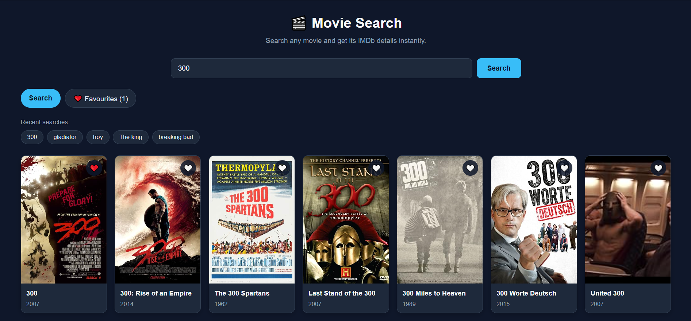

# 🎬 Movie Search

> Search any movie, read its IMDb details, and save your favourites. A full-stack app built with React and Express, powered by the OMDb API.




---

## ✨ Features

- 🔍 **Search movies** by title and browse results in a poster grid
- 📄 **Detailed view** with rating, runtime, genre, director, writer, cast and full plot
- ❤️ **Favourites** saved on the server, so they survive refreshes and cleared browser data
- 🕘 **Recent searches** (last 5) for one-click repeat searches
- ⚠️ Clear **loading and error states** (no results, too many results, network problems)
- 🖼️ **Poster fallback** when a movie has no image

## 🛠️ Tech Stack

| Layer | Technology |
|---|---|
| Frontend | React (hooks, component-based UI), CSS |
| Backend | Node.js, Express |
| Data source | [OMDb API](https://www.omdbapi.com/) |
| Storage | JSON file (favourites), `localStorage` (recent searches) |

## 🧱 Architecture

```
React (:3000)  ──/api/*──▶  Express (:5000)  ──▶  OMDb API
                                  │
                                  └──▶ favorites.json
```

The Express server acts as a **proxy**, so the OMDb API key stays on the server and is never exposed in the browser bundle.

## 📁 Project Structure

```
movie-search-app/
├─ public/
├─ server/
│  ├─ index.js            # Express routes (OMDb proxy + favourites)
│  ├─ .env                # OMDB_KEY (not committed)
│  └─ package.json
├─ src/
│  ├─ components/
│  │  ├─ SearchBar.jsx
│  │  ├─ Tabs.jsx
│  │  ├─ RecentSearches.jsx
│  │  ├─ MovieGrid.jsx
│  │  ├─ MovieCard.jsx
│  │  └─ MovieDetails.jsx
│  ├─ App.jsx             # State and API calls
│  ├─ App.css
│  └─ utils.js
└─ package.json
```

`App.jsx` owns the state and logic; the components only render UI and receive data and handlers as props.

## 🚀 Getting Started

### Prerequisites

- [Node.js](https://nodejs.org/) 18 or newer
- A free OMDb API key from [omdbapi.com/apikey.aspx](https://www.omdbapi.com/apikey.aspx)

### Installation

```bash
# 1. Install frontend dependencies
npm install

# 2. Install backend dependencies
cd server
npm install
cd ..
```

### Configuration

Create `server/.env`:

```env
OMDB_KEY=your_api_key_here
```

### Run the app

Open **two terminals**:

```bash
# Terminal 1: backend (http://localhost:5000)
cd server
node index.js

# Terminal 2: frontend (http://localhost:3000)
npm start
```

The frontend forwards `/api/*` requests to the backend using the `"proxy"` setting in the root `package.json`.

## 🔌 API Reference

| Method | Endpoint | Description |
|---|---|---|
| `GET` | `/api/search?q=<title>` | Search movies by title |
| `GET` | `/api/movie/:id` | Get full details for one movie (IMDb ID) |
| `GET` | `/api/favorites` | List saved favourites |
| `POST` | `/api/favorites` | Add a favourite |
| `DELETE` | `/api/favorites/:id` | Remove a favourite |

## ⚠️ Known Limitations

- Favourites are shared by everyone using the server (no user accounts yet)
- A JSON file is used instead of a real database to keep the backend minimal
- Search returns only the first page of OMDb results (10 movies)

## 🗺️ Roadmap

- [ ] Pagination / "Load more"
- [ ] Cancel outdated requests with `AbortController`
- [ ] User accounts, so each user has their own favourites
- [ ] Move favourites to MongoDB or SQLite
- [ ] Tests with React Testing Library

## 👤 Author

Built by **Piyush** as part of a self-taught journey into full-stack web development.

Data provided by the [OMDb API](https://www.omdbapi.com/).